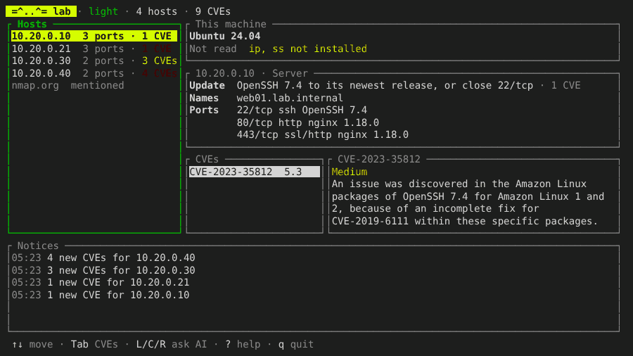
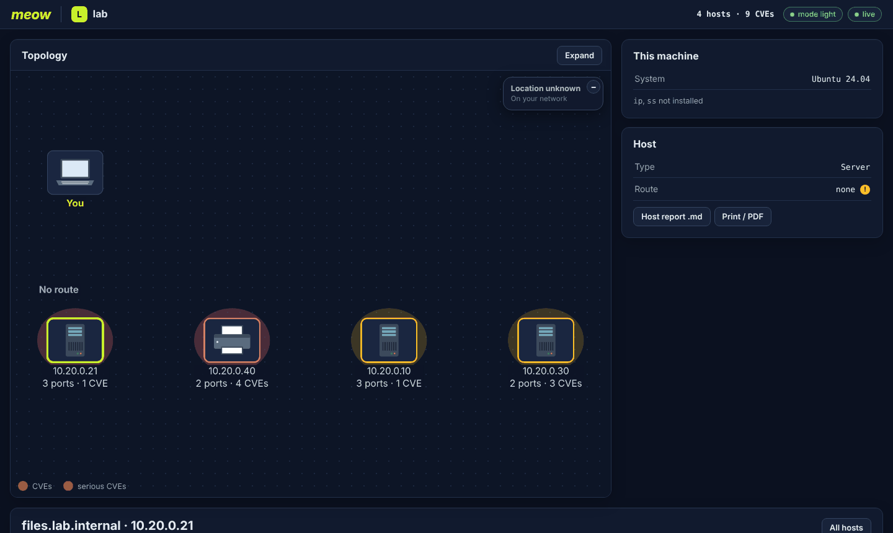
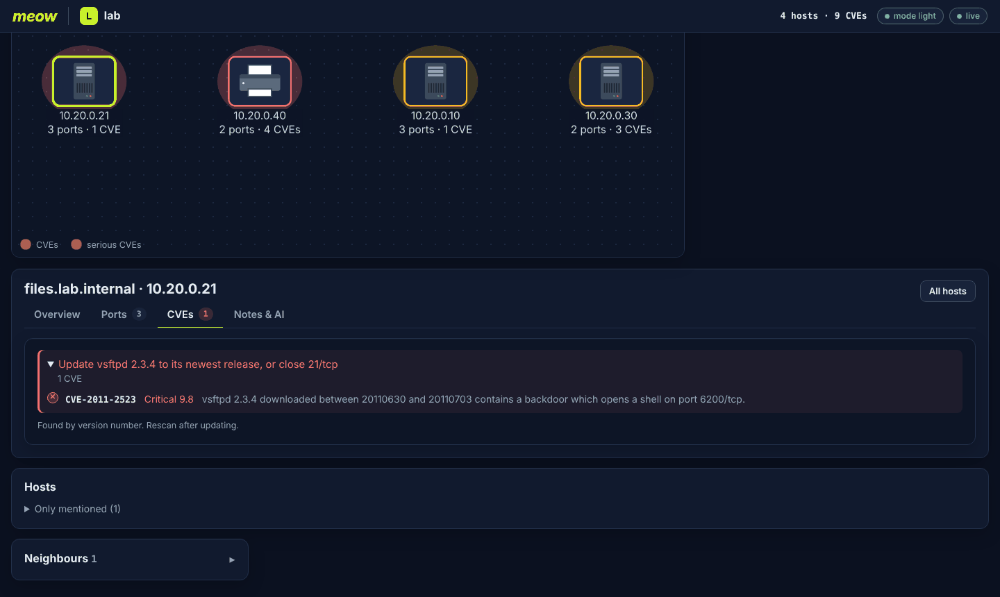

# meow

[](https://github.com/Jrdelt/meow/actions/workflows/checks.yml)
[](https://github.com/Jrdelt/meow/actions/workflows/fuzz.yml)
[](https://github.com/Jrdelt/meow/releases/latest)
[](LICENSE)
[](Cargo.toml)

```text
  /\_/\
 ( ^w^ )  meow: local security triage shell, topology mapper and audit workspace
  > ^ <
```

meow is a command-line tool for checking networks you are allowed to test. It runs your normal shell and reads what your commands print. From that output it builds a map of the hosts, open ports and software it has seen, and looks up known vulnerabilities for the software versions it finds. Session data stays on your computer. meow is written in Rust, with one small part in C.

> **Authorized use only.** Use meow only on systems you own or have written permission to test. meow lists services, settings and public advisories so you can patch and verify. It never writes exploits or attacks.

## See it

`meow hud` shows a session in the terminal. Here a saved Nmap scan of a lab network ([docs/demo/scan.nmap](docs/demo/scan.nmap)) was printed in a session: meow found 4 hosts, matched their software versions to 9 CVEs, and lists what to update.



`meow map` shows the same session in the browser. A red ring marks a host with a critical or high CVE, and its CVE tab says what to update.

| Topology | A host's CVEs |
|---|---|
|  |  |

`meow report` turns the same session into Markdown, with no network and no AI: see the [sample report](docs/sample-report.md).

## What it does

- **Works inside your shell.** meow runs `zsh`, `bash`, `fish` or PowerShell (`pwsh`) and watches what your commands print. When a command such as `nmap`, `curl`, `dig` or `ssh` shows a host, an open port, a service banner (the text a service sends when you connect), an HTTP path or a configuration diff (from `git diff`), meow records it in the session's graph of hosts and services. Watching sends nothing to the hosts you test.
- **Looks up known vulnerabilities.** In the background, meow matches the software versions it found against NVD (the US National Vulnerability Database), OSV.dev (an open vulnerability database) and CISA KEV (a US government list of vulnerabilities known to be exploited in real attacks). It lists CVEs (public IDs for known vulnerabilities) with known exploited ones first and, when known, the release that fixes them. An optional NVD API key lets meow ask NVD more often.
- **Scans when you ask.** `meow recon <target>` runs 17 stages, one at a time: DNS records, subdomains, open ports, service versions, web headers, TLS (the encryption behind HTTPS), SSH settings, crawling the site, exposed keys in its scripts, and more. It needs `mild` or `aggressive` mode; the default `light` mode refuses it. If a tool a stage needs is missing, that stage is skipped.
- **Draws a live map.** `meow map` opens a page in your browser, served only on your own computer (`127.0.0.1`) and protected by a token for that session. It shows the path from you to each target. Each host has tabs for ports, web and TLS, DNS and mail, CVEs, and notes.
- **Keeps private data out of cloud AI.** You can ask a local or cloud AI model to help triage a host. Before any text goes to a cloud model, meow's Privacy Vault replaces IP addresses, host names, domains, email addresses, MAC addresses, credentials and other private values with placeholders such as `<<HOST_01>>`. Keys found during a recon go straight into the vault, and the report lists them so you can rotate (replace) them.
- **Writes a report.** `meow report` writes `REPORT.md` in the session folder. The map can also export the whole session, or one host, as Markdown or as a printable PDF.

## Install

### Homebrew (macOS and Linux)

```sh
brew tap Jrdelt/meow https://github.com/Jrdelt/meow.git
brew trust Jrdelt/meow   # Homebrew 7+
brew install meow
```

This also installs the scanners meow uses (`nmap`, `katana`, `feroxbuster`) and a wordlist. Use `brew install --HEAD meow` to build the latest `main` branch.

### macOS installer

Download `meow-<version>-macos-arm64.pkg` (Apple Silicon) or `meow-<version>-macos-x86_64.pkg` (Intel) from the [latest release](https://github.com/Jrdelt/meow/releases/latest) and open it. It installs `/usr/local/bin/meow`.

The installer is not signed, so macOS blocks it the first time. On macOS 15 (Sequoia) and newer, open **System Settings → Privacy & Security**, scroll down and click **Open Anyway**. On macOS 14 and earlier, Control-click the `.pkg` in Finder and choose **Open**.

### Build from source (macOS and Linux)

```sh
git clone https://github.com/Jrdelt/meow.git
cd meow
./install.sh
```

`install.sh` first adds what is missing (a C compiler, Rust 1.89 or newer, the scanners, a wordlist and an offline location database), then builds meow into `~/.cargo/bin/meow`. `./install.sh --dry-run` shows the plan without changing anything.

### Windows

Download `meow-<version>-windows-x86_64.zip` from the [latest release](https://github.com/Jrdelt/meow/releases/latest) (x64, or ARM64 under emulation), unzip it, and put `meow.exe` in a folder on your `PATH`.

To build from source instead, clone the repository and run this in PowerShell inside the clone. It installs what is missing with `winget` or `scoop`:

```powershell
powershell -ExecutionPolicy Bypass -File .\install.ps1
```

### After installing

Every release file has a `.sha256` file next to it, so you can check the download. Linux `.tar.gz` downloads are on the release page too. Run `meow tools` to add any missing scanner, wordlist or location database. The [user guide](docs/USER_GUIDE.md#install-in-detail) has every install option, and how to update and remove meow.

## Quick start

```sh
meow          # the first time: opens the setup wizard
meow acme     # open (or create) a session named "acme"
```

The first time you run `meow`, a setup wizard takes you through five short steps: the default mode, a local AI server, a cloud AI service (or none), lookups and tools, then a review before it saves. The defaults work.

`meow acme` opens your shell inside a session named `acme`. A new session asks where to save it. Work as usual: meow records what your commands print. Type `exit` to leave, and run `meow acme` again to come back.

Inside the session, switch to `mild` mode to scan a target you are authorized to test:

```sh
meow mode mild
meow recon example.com   # replace with a host you own or have written permission to test
meow map       # the live map in your browser
meow report    # writes REPORT.md in the session folder
```

## Modes

The mode decides what `meow recon` may send to a target. Every mode watches your shell.

| Mode | `meow recon` | What a recon sends |
| :--- | :--- | :--- |
| `light` (default) | Refused | Nothing: 0 packets to hosts |
| `mild` | Allowed | Slower scans: `nmap -sS -T3 --top-ports 1000`, `katana` depth 2, `feroxbuster` at 20 requests/s |
| `aggressive` | Allowed, for labs and authorized hosts only | Faster, fuller scans: `nmap -sS -T4 -p- -O`, `katana` depth 4, `feroxbuster --auto-tune` |

`nmap` finds open ports and services, `katana` crawls a website's links, and `feroxbuster` looks for web files and folders that are not linked. Switch with `meow mode light`, `meow mode mild` or `meow mode aggressive`. Light mode cannot stop a command you type yourself.

## Privacy

- Session data stays on your computer, in folders only your user can read.
- CVE lookups send only software names and versions to NVD, OSV.dev and CISA KEV, never a scanned host's address or name.
- Cloud AI is optional and can be turned off completely. Text is masked before it goes out, and meow refuses to send if anything private is left. A local AI server gets unmasked text only when meow can see that it is yours.
- The map can estimate your computer's rough location from your public address (through ipinfo.io) and show satellite pictures of the area (from EOX). Both can be turned off in `~/.meow/config.toml`.
- `REPORT.md` is not masked. Review it before you share it.

The [threat model](docs/THREAT_MODEL.md) lists everything that leaves your machine, and when.

## Learn more

| Document | What it covers |
| :--- | :--- |
| [User guide](docs/USER_GUIDE.md) | Every command, sessions, recon stages, the map and HUD, AI settings, `config.toml`, updating, troubleshooting and removal |
| [How meow works](docs/ARCHITECTURE.md) | The design: output capture, the C terminal filter, parsers, CVE matching, storage and the vault |
| [Threat model](docs/THREAT_MODEL.md) | What meow protects, what it does not trust, what leaves your machine, and the tests behind it |
| [Sample report](docs/sample-report.md) | An example `REPORT.md` |
| [Fuzzing](fuzz/README.md) | How the parsers and the C filter are fuzz-tested |
| [Security policy](SECURITY.md) | How to report a problem, what is in scope, and known limits |

## Reporting a security problem

Please report security problems privately through [GitHub's private vulnerability reporting](https://github.com/Jrdelt/meow/security/advisories/new), not in a public issue. [SECURITY.md](SECURITY.md) has the details.

## License

meow is released under the [MIT License](LICENSE). The LICENSE file also lists the third-party parts meow uses.
