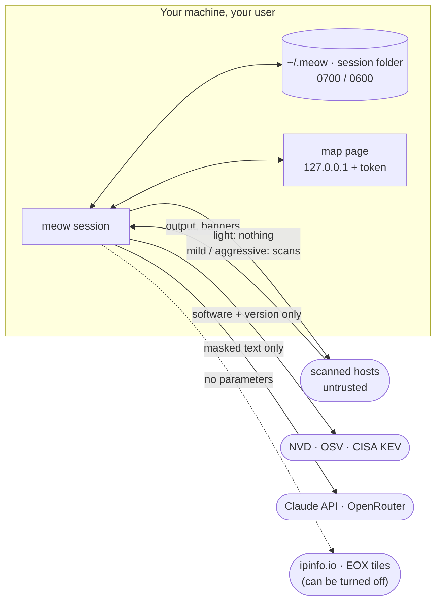

# Threat model

This page covers what meow protects, what it does not trust, what leaves your
machine, and how the masking of private values is tested.
[SECURITY.md](../SECURITY.md) has the reporting policy, the full scope and the
known limits. [ARCHITECTURE.md](ARCHITECTURE.md) explains the parts named here.

File references point at the source as of v0.2.7 and may drift.

## What meow protects

| Asset | Where it lives |
|---|---|
| Findings about the systems you test: addresses, names, ports, versions, paths, CVEs | `graph.json` and `state.db` in the session folder |
| Secrets seen during the session: keys, tokens, passwords in output | the vault in `state.db`; never sent in clear |
| Your API keys (Claude API, OpenRouter, NVD) | `~/.meow/ai.toml`, `~/.meow/config.toml` |
| The session token for the map and the HUD | `runtime.json`, only while the session runs |
| Your shell history and command trail | the session folder |
| Your machine itself: meow runs tools and reads untrusted text on it | |

## Whom meow does not trust

- **The systems you scan.** Everything they say is data, never instructions:
  banners, HTTP headers, certificates, reverse DNS, page content. A host can
  call itself anything, so a name from text never moves or takes over a host
  (src/graph.rs, src/vault.rs).
- **Files you import** with `meow add`, and the output of nmap, katana and
  feroxbuster.
- **AI models and their replies.** Model output is filtered as it streams and
  never fills in secrets (src/ai.rs, src/vault.rs).
- **Session folders that came from elsewhere** (cloned, unpacked, copied).
  They open only after you accept them, their history is dropped, and a scan
  queued in their files never runs (src/workspace.rs).
- **The session database.** It is opened with SQLite's defensive mode, no views
  or triggers, and `trusted_schema` off (src/db.rs).
- **Other users and programs on your machine.** They must not read session data,
  use the map server or take an API key (see below).

meow trusts you, your operating system, and the scanners themselves (they are
out of scope, see SECURITY.md).

## What leaves your machine

| Destination | What is sent | When |
|---|---|---|
| The systems you test | Nothing in **light** mode (the default). Slow scans in **mild**, fast ones in **aggressive** (src/mode.rs, src/queue/mod.rs) | `meow recon`, **Check now** |
| services.nvd.nist.gov | A CPE name, or a product name and version | CVE lookups (`[cve] enabled`) |
| api.osv.dev | Package name, ecosystem and version | CVE lookups |
| www.cisa.gov | A plain download of the KEV catalog, cached 7 days | CVE lookups |
| ipinfo.io | Nothing; it sees your public address. Never while a VPN carries all traffic | Map open (`[location] enabled`) |
| tiles.maps.eox.at | Tile numbers for a rough area | Map open (`[location] map`) |
| api.anthropic.com, openrouter.ai | **Masked** prompts and your key for that service only | When you ask cloud AI (`C`, `R`) |
| A local AI server | Unmasked only if meow counts it as yours ([SECURITY.md](../SECURITY.md#known-limits) says when); otherwise masked, and no key | When you ask local AI (`L`) |
| crt.sh, DNS-over-HTTPS, RDAP, Team Cymru | Public names and addresses of your target; never internal names | Recon stages, mild and aggressive only |
| GitHub | Release metadata and downloads | `meow update` |
| raw.githubusercontent.com, download.db-ip.com, your package manager | Plain downloads of the wordlist and the DB-IP Lite database; installs of missing scanners (else a `cargo`/`go` build) | `meow tools` and the first-session and `meow recon` offers (they ask first unless `--yes` or `--install-tools`); `meow update` of a source build on macOS and Linux, without asking |
| crates.io, static.rust-lang.org, sh.rustup.rs | Crate downloads for the rebuild; Rust itself only when it is missing or too old | `meow update` of a source build on macOS and Linux, without asking |
| Homebrew | Its own update, and upgrades of meow and of outdated `nmap`, `katana` and `feroxbuster` | `meow update` of a Homebrew install, without asking |

**CVE lookups carry no scanned host's address or name.** Lookups are built only
from CPE names and product/version pairs (`plan` and `software_lookups` in
src/cve.rs). CPE fields are validated (src/cpe.rs), and keyword tokens must pass
`is_safe_keyword_token`: no `://`, no leading `-`, only letters, digits and
`. _ + - ~`. The test `grounding_finds_cves_from_versions_and_packages`
checks that the scanned address never appears in a request. No CVE, location
or tile request follows a redirect.

## Cloud AI: how private values are masked

The vault (src/vault.rs) replaces private values with stable placeholders such
as `<<HOST_01>>` before any text goes to a cloud model.

| Kind | Examples |
|---|---|
| `HOST` | IPv4 (also encoded forms), IPv6, MAC addresses |
| `DOM` | internal and registered domain names, NetBIOS and LDAP names |
| `USER` | user names, email local parts, your own login |
| `PATH` | file paths |
| `SEC` | private keys, JWTs, known key prefixes (`AKIA`, `sk-ant`, `ghp_`, ...), password hashes, `Authorization` headers, cookies, `key=value` credentials, credentials in URLs, high-entropy blobs |

Order of operations for every cloud request (src/ai.rs, `mask_prompt`):

1. Register every value the graph knows, plus your own login.
2. Scope the request to the host being triaged.
3. Mask every JSON string value. Scan text travels only inside the
   `untrusted_scan_data` field, apart from the instructions.
4. Drop your notes, unless you turned on `cloud_notes`.
5. Scan the masked request again with `leaks_json`. **If anything private is
   left, meow refuses to send.**
6. Check the daily caps: $1.00 and 20 calls by default, shared by all
   sessions. Each call's maximum cost is set aside before it is sent, and an
   unreadable ledger turns cloud AI off (src/usage.rs).

Replies are unmasked as they stream, but only the triaged host's own values,
only in prose, never secrets, and never inside code, commands or links that
point elsewhere. The cache keeps the masked reply.

Cloud AI can be turned off completely: **Off** in `meow setup`,
`meow setup --cloud-off`, or `disable_cloud = true` in `~/.meow/ai.toml`. It is
also off while `config.toml`, `ai.toml` or `~/.meow/ai-usage` cannot be read.

## How the redaction is verified

These tests run on macOS, Linux and Windows on every push to `main`.

**The vault (src/vault.rs)**

- `hosts_names_and_paths_become_stable_placeholders`: the same value always gets
  the same placeholder.
- `secrets_are_masked_and_flagged_for_rotation` and
  `common_secret_formats_do_not_pass`: headers, cloud keys, JWTs, private keys
  and other formats become `SEC`.
- `names_users_and_address_forms_the_graph_never_saw_are_masked`.
- `host_names_in_script_url_paths_and_numeric_hosts_are_vaulted` and
  `ipv6_port_custom_auth_paths_and_public_suffixes_are_handled`.
- `public_software_identifiers_are_left_alone`: product names and versions stay
  readable, so the model can still reason about them.
- `streamed_replies_are_unmasked_across_chunk_boundaries`: tries every split
  point of a streamed reply.
- `a_reply_gets_back_only_what_its_request_held`,
  `a_placeholder_inside_a_link_to_elsewhere_is_not_filled_in` and
  `a_reply_never_fills_in_secrets_or_values_beside_somewhere_else`.
- `stream_unmasker_blocks_piggybacked_schemeless_html_and_oversized_link_bypasses`.

**The requests (src/ai.rs)**

- `cloud_triage_is_masked_streamed_unmasked_cached_and_billed`: the body sent
  holds none of the test's addresses, domain, user, path or JWT.
- `scraped_text_only_ever_appears_inside_the_untrusted_field`.
- `notes_stay_here_and_named_secrets_never_reach_the_cloud`.
- `web_and_dns_findings_reach_the_cloud_masked_only` and
  `every_domain_of_a_long_spf_record_is_masked`.
- `a_name_on_the_cut_of_a_long_claim_never_goes_out_in_part` and
  `a_quoted_secret_the_cut_runs_through_is_still_masked`: truncation never
  leaks part of a value.
- `windows_names_and_encoded_addresses_never_leave_in_clear`.
- `a_reply_cannot_take_private_values_out_through_a_link`.
- `a_local_server_on_another_machine_gets_masked_text` and
  `a_port_of_another_user_gets_no_key_and_no_evidence`.
- `a_key_in_the_environment_goes_only_to_its_own_service`.
- `the_daily_caps_hold_for_all_sessions_together`,
  `an_unreadable_usage_record_turns_the_cloud_off` and
  `an_unreadable_setup_file_turns_the_cloud_off`.

**Public lookups (src/osint/tests.rs)**

- `internal_names_and_private_reverse_names_stay_off_public_services`,
  `crt_sh_is_not_asked_about_an_internal_name` and
  `an_internal_target_is_never_asked_over_doh`.

**Fuzzing (fuzz/)**

The parsers that turn untrusted text into findings, and the C terminal filter,
are fuzzed with cargo-fuzz and AddressSanitizer ([fuzz/README.md](../fuzz/README.md)).

## Local attack surface

| Surface | Protection |
|---|---|
| Map server | Binds to `127.0.0.1` only. A 256-bit token is required (Bearer header or `?token=`, never a cookie) and compared in constant time. `Host` must be loopback and `Origin` meow's own. Connection, WebSocket and frame limits (src/coordinator.rs) |
| Map page | Strict Content Security Policy (`default-src 'none'`, scripts from itself only), `X-Frame-Options: DENY`, `nosniff`, `no-referrer`, `no-store` (src/webui.rs). The page ignores any socket that does not prove it is its own session |
| Browser opener | A private `0600` page; the token never goes on a command line |
| Helper commands | Loopback HTTP with the token, no proxy, no redirects. `runtime.json` is trusted only while its session holds the lock (src/ipc.rs) |
| Files | `0700` folders and `0600` files, opened without following links. Folders others can write to are refused (src/workspace.rs, src/perms.rs) |
| Scan tools | Own process group, stdin closed, timeouts, output caps, secret-looking environment variables removed (src/queue/runner.rs) |
| Updates | Release downloads checked by SHA-256 from GitHub over HTTPS only. Source updates refuse links, submodules, unexpected git settings and local changes (src/release.rs, src/update.rs) |

## Threats and what stops them

| Threat | Mitigation |
|---|---|
| A scanned host plants instructions for the AI in a banner or page | Scan text travels only in `untrusted_scan_data`; the system prompt treats it as data; replies are filtered |
| A host claims another host's name to redirect findings | Names from text are claims; they never move or take over a host |
| Hostile XML or JSON exhausts memory or the stack | Bounded entity expansion, depth and attribute caps (tests in src/parsers/nmap.rs); a 50 MB import cap; fuzzing |
| Escape sequences in output hide or forge text | The C filter removes them before parsing; fuzzed under AddressSanitizer |
| A private value reaches a cloud model | Vault masking, then a second scan; meow refuses to send on any leak |
| A reply leaks values through a link | Placeholders in links to elsewhere are never filled in |
| Runaway cloud spend | Daily caps across all sessions; costs reserved before each call |
| Another local user reads findings or uses the map | Private file modes, the loopback token, Host and Origin checks |
| A shared or cloned folder runs a planted command | Foreign sessions need your acceptance; their history is dropped; queued scans never run |
| A tampered update | SHA-256 checks; hardened git; source updates are fast-forward only |
| Scanning without permission | Light mode by default sends nothing to targets; recon needs mild or aggressive |

## Known gaps

SECURITY.md lists every known limit. In short:

- On Windows, meow does not check who can write to folders above a session.
- Some git and history tampering between sessions goes unnoticed.
- A process a scan tool starts in a session of its own (`setsid`) is not
  stopped.
- A local AI server meow counts as yours gets unmasked text, including one
  reached over an `ssh -L` forward and, on Linux, one run by root.
- Masking can miss a name shaped like an advisory ID, and free-text notes. This
  is why notes are not sent by default.
- With OpenRouter, a day can end over the cap.
- Light mode cannot stop a command you type yourself.
