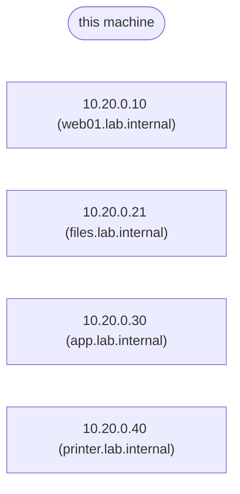

<!-- Sample output. Made by `meow report` in a session where the saved scan
docs/demo/scan.nmap (lab addresses) was printed with `cat`, so no host was
scanned; the CVEs are real NVD/OSV matches for the versions in it. Only the
folder path in the command trail was shortened. -->

# Audit report: lab

Generated 2026-11-23T05:25:27Z by meow 0.2.6 from local workspace files (no AI, no network). Mode: light.

| Hosts | CVEs | Known exploited | Secrets to rotate |
|---|---|---|---|
| 4 | 9 | 0 | 0 |

> This report is not masked. It contains real addresses and host names, and the command trail may contain credentials typed during the session. Review it before sharing.

## Topology



## What to update

One line per piece of software. CVEs are found by version number: a system that takes security updates from its vendor may already have the fix under the same version number.

- 10.20.0.10 (web01.lab.internal): Update OpenSSH 7.4 to its newest release, or close 22/tcp if the service is not needed. (1 CVE)
- 10.20.0.21 (files.lab.internal): Update vsftpd 2.3.4 to its newest release, or close 21/tcp if the service is not needed. (1 CVE)
- 10.20.0.30 (app.lab.internal): Update Apache Tomcat 9.0.30 to a release newer than 9.0.64, or close 8080/tcp if the service is not needed. (3 CVEs)
- 10.20.0.40 (printer.lab.internal): Update CUPS 2.2 to a release newer than 2.3.3op2-2.1, or close 631/tcp if the service is not needed. (4 CVEs)

## CVEs

### 10.20.0.21 (files.lab.internal)

#### vsftpd 2.3.4 · 21/tcp

| CVE | Severity | Known exploited | Fixed in | Summary |
|---|---|---|---|---|
| CVE-2011-2523 | Critical 9.8 | - | - | vsftpd 2.3.4 downloaded between 20110630 and 20110703 contains a backdoor which opens a shell on port 6200/tcp. |

### 10.20.0.40 (printer.lab.internal)

#### CUPS 2.2 · 631/tcp · affected up to 2.3.3op2-2.1

| CVE | Severity | Known exploited | Fixed in | Summary |
|---|---|---|---|---|
| CVE-2018-6553 | High 8.8 | - | - | The CUPS AppArmor profile incorrectly confined the dnssd backend due to use of hard links. A local attacker could possibly use this issue to escape confinement. This flaw affects versions prior to |
| CVE-2017-18190 | High 7.5 | - | 2.2.2 | A localhost.localdomain whitelist entry in valid\_host() in scheduler/client.c in CUPS before 2.2.2 allows remote attackers to execute arbitrary IPP commands by sending POST requests to the CUPS daemon |
| CVE-2017-18248 | Medium 5.3 | - | 2.2.6 | The add\_job function in scheduler/ipp.c in CUPS before 2.2.6, when D-Bus support is enabled, can be crashed by remote attackers by sending print jobs with an invalid username, related to a D-Bus |
| CVE-2021-25317 | Low 3.3 | - | 2.2.7 | A Incorrect Default Permissions vulnerability in the packaging of cups of SUSE Linux Enterprise Server 11-SP4-LTSS, SUSE Manager Server 4.0, SUSE OpenStack Cloud Crowbar 9; openSUSE Leap 15.2, Factory |

### 10.20.0.30 (app.lab.internal)

#### Apache Tomcat 9.0.30 · 8080/tcp · affected up to 9.0.64

| CVE | Severity | Known exploited | Fixed in | Summary |
|---|---|---|---|---|
| CVE-2022-34305 | Medium 6.1 | - | newer than 9.0.64 | In Apache Tomcat 10.1.0-M1 to 10.1.0-M16, 10.0.0-M1 to 10.0.22, 9.0.30 to 9.0.64 and 8.5.50 to 8.5.81 the Form authentication example in the examples web application displayed user provided data |
| CVE-2019-17569 | Medium 4.8 | - | newer than 9.0.30 | The refactoring present in Apache Tomcat 9.0.28 to 9.0.30, 8.5.48 to 8.5.50 and 7.0.98 to 7.0.99 introduced a regression. The result of the regression was that invalid Transfer-Encoding headers were |
| CVE-2020-1935 | Medium 4.8 | - | newer than 9.0.30 | In Apache Tomcat 9.0.0.M1 to 9.0.30, 8.5.0 to 8.5.50 and 7.0.0 to 7.0.99 the HTTP header parsing code used an approach to end-of-line parsing that allowed some invalid HTTP headers to be parsed as |

### 10.20.0.10 (web01.lab.internal)

#### OpenSSH 7.4 · 22/tcp

| CVE | Severity | Known exploited | Fixed in | Summary |
|---|---|---|---|---|
| CVE-2023-35812 | Medium 5.3 | - | - | An issue was discovered in the Amazon Linux packages of OpenSSH 7.4 for Amazon Linux 1 and 2, because of an incomplete fix for CVE-2019-6111 within these specific packages. The fix had only covered |

## Hosts

Only mentioned, not scanned: nmap.org.

### 10.20.0.10 (web01.lab.internal)

| Port | State | Service | Product | Version | Extra |
|---|---|---|---|---|---|
| 22/tcp | open | ssh | OpenSSH | 7.4 | - |
| 443/tcp | open | ssl/http | nginx | 1.18.0 | - |
| 80/tcp | open | http | nginx | 1.18.0 | - |

Observations:

- host is up _(pty_regex, Medium, 2026-11-23T05:22:55Z)_
- hostname web01.lab.internal _(pty_regex, Medium, 2026-11-23T05:22:55Z)_
- 22/tcp ssh OpenSSH 7.4 open _(pty_regex, Medium, 2026-11-23T05:22:55Z)_
- 443/tcp ssl/http nginx 1.18.0 open _(pty_regex, Medium, 2026-11-23T05:22:55Z)_
- 80/tcp http nginx 1.18.0 open _(pty_regex, Medium, 2026-11-23T05:22:55Z)_

### 10.20.0.21 (files.lab.internal)

| Port | State | Service | Product | Version | Extra |
|---|---|---|---|---|---|
| 139/tcp | open | netbios-ssn | Samba smbd | 3.X - 4.X | - |
| 21/tcp | open | ftp | vsftpd | 2.3.4 | - |
| 445/tcp | open | netbios-ssn | Samba smbd | 4.6.2 | - |

Observations:

- host is up _(pty_regex, Medium, 2026-11-23T05:22:55Z)_
- hostname files.lab.internal _(pty_regex, Medium, 2026-11-23T05:22:55Z)_
- 139/tcp netbios-ssn Samba smbd 3.X - 4.X open _(pty_regex, Medium, 2026-11-23T05:22:55Z)_
- 21/tcp ftp vsftpd 2.3.4 open _(pty_regex, Medium, 2026-11-23T05:22:55Z)_
- 445/tcp netbios-ssn Samba smbd 4.6.2 open _(pty_regex, Medium, 2026-11-23T05:22:55Z)_

### 10.20.0.30 (app.lab.internal)

| Port | State | Service | Product | Version | Extra |
|---|---|---|---|---|---|
| 22/tcp | open | ssh | OpenSSH | 9.6p1 Ubuntu 3ubuntu13.5 | - |
| 8080/tcp | open | http | Apache Tomcat | 9.0.30 | - |

Observations:

- host is up _(pty_regex, Medium, 2026-11-23T05:22:55Z)_
- hostname app.lab.internal _(pty_regex, Medium, 2026-11-23T05:22:55Z)_
- 22/tcp ssh OpenSSH 9.6p1 Ubuntu 3ubuntu13.5 open _(pty_regex, Medium, 2026-11-23T05:22:55Z)_
- 8080/tcp http Apache Tomcat 9.0.30 open _(pty_regex, Medium, 2026-11-23T05:22:55Z)_

### 10.20.0.40 (printer.lab.internal)

| Port | State | Service | Product | Version | Extra |
|---|---|---|---|---|---|
| 631/tcp | open | ipp | CUPS | 2.2 | - |
| 80/tcp | open | http | lighttpd | 1.4.35 | - |

Observations:

- host is up _(pty_regex, Medium, 2026-11-23T05:22:55Z)_
- hostname printer.lab.internal _(pty_regex, Medium, 2026-11-23T05:22:55Z)_
- 631/tcp ipp CUPS 2.2 open _(pty_regex, Medium, 2026-11-23T05:22:55Z)_
- 80/tcp http lighttpd 1.4.35 open _(pty_regex, Medium, 2026-11-23T05:22:55Z)_

## Secrets to rotate

No secret has been seen in data prepared for the cloud tiers.

## Background tasks

No recon task was queued.

## Command trail (replay.sh)

```sh
# meow replay log. One entry per command:
#   # [CWD] <directory the command was started in>
#   <the command as typed>
#   # [EXIT] <exit code>   (absent if the session ended while it was running)
# [CWD] /home/you/meow
cat docs/demo/scan.nmap
# [EXIT] 0
# [CWD] /home/you/meow
meow report
```

## AI triage notes

No AI request was made.

